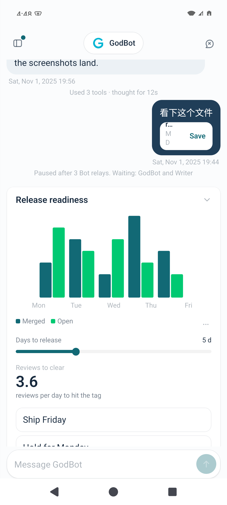

<p align="center">
  
</p>

# Godbot for Android

Chat with your Bots, respond to approval requests, and manage your Godbot team from your phone. Your Bots and their tools run on the computer that hosts Godbot in dsh.

**[Download the Android APK][releases]** · [Set up Godbot on your computer][desktop]

## Install and pair

1. Download `godbot-<version>.apk` from the latest [GitHub Release][releases]. The APK supports Android 7.0 (API 24) or later on ARM phones (`arm64-v8a` and `armeabi-v7a`).
2. Open the APK and allow installs from that source if Android prompts. If you have the older debug-signed test build, uninstall it first. Uninstalling clears the app's local settings and pairings.
3. On your computer, open Godbot's **Settings → Phone**. Enter a relay address such as `wss://<your relay>/v1/link`, enable phone access, and show the pairing QR code.
4. In the Android app, tap **Use the camera** to scan the QR code, or paste the pairing link. If you open a `godbot://pair?…` link from another app, check the computer and server shown before tapping **Pair**.

Open a Bot from the team list and send a message. To pair or switch to another computer, use **Settings → Computers**. If the app asks for a Godbot upgrade, update the desktop plugin and reconnect.

## Remote computers

Choose **Remote computers** in the drawer, in **Settings → Computers**, or on the
initial pairing screen. Install Godbot Computer Host on the target and generate
a machine pairing offer there. Scan it or paste its link on the phone. Confirm
the displayed host fingerprint before pairing. Machine pairings and team
pairings have independent saved lists. Returning to your team restores its link.

For an available display, choose **View desktop**. The Android WebRTC viewer
starts in view-only mode. **Request control** asks the host to grant pointer and
keyboard access. The trackpad supports relative movement, tap, long-press drag,
and two-finger scrolling. Use **Keyboard** for composed text and shortcuts, and
**Display settings** to change the monitor, zoom, or inspect the negotiated route.
Shell access requires its own host grant. **Open terminal** shows the target
account and opens an xterm session, including on a headless Linux server. Going
to the background ends the machine session.

## What you can do

- **Continue a conversation.** Read replies, send messages and attachments, and follow individual Bots or group chats.
- **Respond to your team.** Open **Needs you** to find questions and approvals that are waiting for you.
- **Manage Godbot remotely.** Edit Bots and groups, review memory and schedules, and check team usage and settings.

<p align="center">
  
  
</p>

<p align="center"><sub>Android screenshots from the built-in demo team.</sub></p>

## Connection and updates

Godbot on your computer and the Android app each make an outbound WebSocket connection to a relay server. The Noise IK handshake establishes end-to-end encryption. The relay forwards encrypted frames between the paired devices. See the [Godbot link implementation][link] for details.

Turn on **Settings → Keep connected in background** for an ongoing Android notification and a foreground service that reconnects when the link drops. If Android stops the service, use the **Battery optimization** and **Auto-start and lock** shortcuts in Settings. Encrypted Firebase push is available for deployments that configure Firebase on both the app and relay.

Use **Settings → About Godbot → Check for app updates** to check the active computer's relay. The app reads `/app/latest.json`, verifies the downloaded APK's size and SHA-256, and opens the Android installer. For a manual download from GitHub, the matching `.apk.sha256` file can be checked with `sha256sum -c`.

## Build from source

Use Node.js 24, JDK 17, and the Android SDK with platform 36. Set `ANDROID_HOME` to the SDK path. Use a development build because Godbot includes a local Expo native module.

```sh
npm ci
npm run typecheck
npm test
npm run android
```

The shared link, UI definitions, and file-transfer code in `godbot/` are checked in. To refresh them, run `GODBOT_SRC=/path/to/dsh-godbot npm run sync:godbot` from a committed desktop checkout with the link sources. Run `npm run check:godbot` to check the copies. [`godbot/SOURCE.json`](godbot/SOURCE.json) records the source revision and file hashes.

### Build a release APK

```sh
npx expo prebuild --platform android --clean
(cd android && ./gradlew assembleRelease -PreactNativeArchitectures=arm64-v8a,armeabi-v7a)
```

The APK is written to `android/app/build/outputs/apk/release/app-release.apk`. Provide `GODBOT_ANDROID_KEYSTORE`, `GODBOT_ANDROID_KEYSTORE_PASSWORD`, `GODBOT_ANDROID_KEY_ALIAS`, and `GODBOT_ANDROID_KEY_PASSWORD` to use a release key. Local builds default to debug signing. Use the same release key for each distributed APK so Android can install updates in place.

Set `EXPO_PUBLIC_GODBOT_DEMO=1` at build time to open the built-in team without pairing. After a demo build, unset the flag and force Metro to regenerate the release bundle with `./gradlew :app:createBundleReleaseJsAndAssets --rerun assembleRelease` from `android/`.

For encrypted Firebase push, set `GODBOT_GOOGLE_SERVICES_JSON` to your project's `google-services.json` before running Expo prebuild and configure the matching service account on the relay. Long-press **Phone app** in **Settings → About Godbot** to trigger a local test of the encrypted notification.

### Tests and CI

The [CI workflow](.github/workflows/ci.yml) runs type checking and tests, checks the shared files against their recorded revision, and builds the APK and checksum as the `godbot-android` artifact. It can sign with a release key using the four signing secrets listed in the workflow, including `GODBOT_ANDROID_KEYSTORE_BASE64` for the keystore.

The GitHub release tag follows the version in `package.json`, for example `v0.1.1`. Publish the release-signed APK with a checksum calculated after signing.

The [end-to-end scripts](e2e/) require `adb` and an Android emulator. Pairing tests accept `GODBOT_E2E_APK` to override the APK path.

| Check | Run |
| --- | --- |
| Pair a standalone host, exercise a real PTY and verify background teardown on a dedicated emulator | `GODBOT_SRC=/path/to/dsh-godbot GODBOT_E2E_MACHINE_RELAY=ws://127.0.0.1:18793/v1/link GODBOT_E2E_APK=/path/to/app.apk ANDROID_SERIAL=emulator-5594 npm run e2e:remote` (start a local relay first) |
| Pair and send a message to a test computer | `GODBOT_E2E_PAIRING_URI='godbot://pair?…' npm run e2e:android` |
| Exercise settings and chat against a real Godbot test harness | `GODBOT_E2E_CONTROL=http://127.0.0.1:47781 npm run e2e:pages` |
| Check the upgrade prompt for an outdated computer | `npm run e2e:incompatible` |
| Check the demo UI | `npm run e2e:demo -- /path/to/demo.apk` |
| Test background reconnect and notifications | `GODBOT_RELAY_BIN=/path/to/godbot-relay node e2e/keepalive.mjs /path/to/app.apk` |
| Test APK download, verification, and installation | `GODBOT_E2E_RELAY_BIN=/path/to/godbot-relay node e2e/update.mjs` |

For graphical acceptance, pair the dedicated emulator with a graphical test host
and grant that phone view and control. Run `npm run e2e:remote-desktop` with
`ANDROID_SERIAL`, `GODBOT_E2E_DESKTOP_NAME`, `GODBOT_E2E_DESKTOP_POINT` (the
normalized x,y center of a text field), and `GODBOT_E2E_DESKTOP_RECEIPT` (a file
updated by that field). Set `GODBOT_E2E_DESKTOP_CONTAINER` if the receipt lives
inside your staging container. `GODBOT_E2E_FORCE_TURN=1` checks the selected RTC
candidate pair before exercising input.

For a local pairing test, start a relay and run `npm run e2e:fake-host -- ws://127.0.0.1:<port>/v1/link` to generate a pairing link and receive test messages. Set `GODBOT_E2E_RELAY_PORT` if the script needs to map the emulator's relay port with `adb reverse`. The desktop repository also provides the `PHONE-ANDROID` end-to-end case for the packaged Godbot plugin.

## License and credits

Godbot for Android is licensed under the [Apache License 2.0](LICENSE). [NOTICE](NOTICE) records third-party licenses and source attribution. [DSH Go][dsh-go] served as a reference for this README.

[releases]: https://github.com/renjiegod/godbot-app/releases/latest
[desktop]: https://github.com/renjiegod/dsh-godbot#readme
[link]: https://github.com/renjiegod/dsh-godbot/tree/main/src/link
[dsh-go]: https://github.com/ccch1mneyyy/dsh-Go
