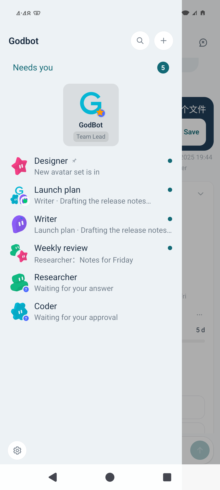

<h1>Godbot for Android</h1>

<strong>Manage your Godbot team from Android.</strong>

Pick up a conversation, respond to an approval request, or connect to your own computer. Your Bots and tools keep running on your Godbot workbench.

<strong><a href="https://github.com/renjiegod/godbot-app/releases/latest">Download the APK</a></strong> · <a href="#install-and-pair">Pair your phone</a> · <a href="https://github.com/renjiegod/dsh-godbot#readme">Godbot for DSH</a> · <a href="README.zh-CN.md">简体中文</a>

Android 7.0+ · ARM64 · Apache-2.0

  
  

Screens from the built-in demo team.

## Install and pair

1. Download `godbot-<version>.apk` from the [latest release](https://github.com/renjiegod/godbot-app/releases/latest). Open it and allow installs from that source if Android asks.
2. On your computer, open **Godbot → Settings → Phone**. Enter your Godbot Server’s WebSocket URL, such as `wss://relay.example.com/v1/link`, enable phone access, and show the pairing QR code.
3. On Android, tap **Use the camera** to scan the code, or paste the pairing link. Check the computer and server shown before tapping **Pair**.

Open a Bot and send a message to confirm your link. Use **Settings → Computers** to pair or switch teams. If the app asks for a Godbot upgrade, update the plugin on the computer and reconnect.

## What you can do

- **Stay in the conversation.** Read replies, send messages or attachments, and follow individual Bots or group chats. In a group, open a member's work to watch its tool calls as they run, and stop it.
- **Respond to approvals.** Open **Needs you** for questions and approval requests from your team.
- **Track and review work.** Open **Work board** in the team drawer or long-press a message to create a draft. Assign it to a Bot, request changes, and accept the current evidence. Your paired computer saves the same item for Web and Android.
- **Manage the team.** Edit Bots and groups, review memory and schedules, and inspect team usage and settings.

## Remote computers

Open **Remote computers** from the drawer, **Settings → Computers**, or the first pairing screen. On the target, set up [Godbot Computer Host](https://github.com/renjiegod/dsh-godbot/tree/main/computer-host) and create a machine pairing offer. Scan it or paste the link and confirm the displayed host fingerprint. Computer pairings are saved separately from team pairings.

- **View desktop** opens the target display in view-only mode. Select **Request control** to ask the host for pointer and keyboard access. Use the trackpad to move the pointer, tap, drag with a long press, or scroll with two fingers. Open **Keyboard** for composed text and shortcuts, and **Display settings** for monitor selection, zoom, and connection details.
- **Open terminal** asks for a separate shell grant and shows the account on the target. It also works on headless Linux. Leaving the app in the background ends the machine session.

## Connection and updates

The phone and computer each dial Godbot Server over an outbound WebSocket. The [Godbot link](https://github.com/renjiegod/dsh-godbot/tree/main/src/link) uses Noise IK to encrypt traffic between paired devices.

Enable **Settings → Keep connected in background** to use Android’s foreground service and reconnect after link drops. If Android stops it, check the **Battery optimization** and **Auto-start and lock** shortcuts in Settings. Deployments with Firebase configured on both ends can also deliver encrypted push notifications.

**Settings → About Godbot → Check for app updates** reads `/app/latest.json` from your active computer’s relay. The app checks the APK size and SHA-256 before opening the Android installer. For a GitHub download, verify the APK with its accompanying `.apk.sha256` using `sha256sum -c`. Android upgrades in place when both APKs use the same signing key. Switching from a differently signed test build requires uninstalling it first, which clears local settings and pairings.

## Build from source

Use Node.js 24, JDK 17, and Android SDK platform 36. Set `ANDROID_HOME` to your SDK path and run `npm ci` followed by `npm run android`.

See the [development guide](docs/development.md) for signing, shared files, demo builds, CI, and emulator tests.

## License and credits

Godbot for Android is licensed under the [Apache License 2.0](LICENSE). [NOTICE](NOTICE) records third-party licenses and attribution. [DSH Go](https://github.com/ccch1mneyyy/dsh-Go) served as a documentation reference.
