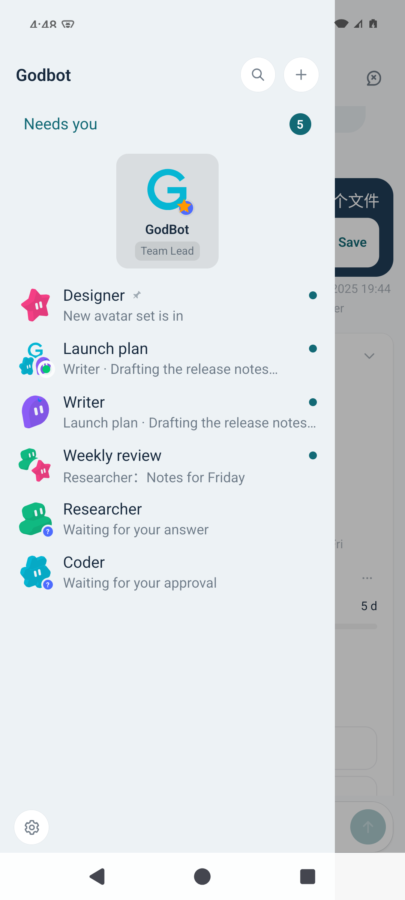
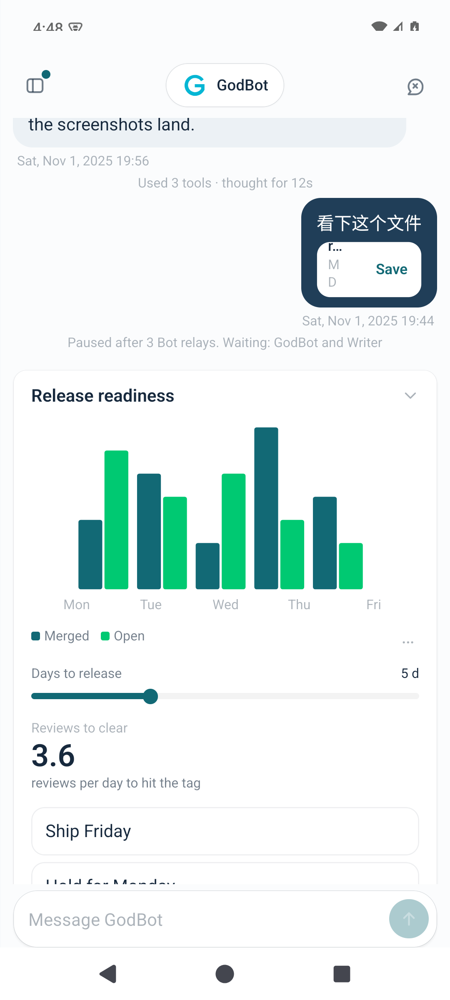

<h1>Godbot Android</h1>

<strong>用 Android 手机管理你的 Godbot 团队。</strong>

接着聊、处理审批，或连接你自己的电脑。Bot 和工具仍在你的 Godbot 工作台运行。

<strong><a href="https://github.com/renjiegod/godbot-app/releases/latest">下载 APK</a></strong> · <a href="#安装与配对">手机配对</a> · <a href="https://github.com/renjiegod/dsh-godbot#readme">电脑端</a> · <a href="README.md">English</a>

Android 7.0+ · ARM64 · Apache-2.0

  
  

截图来自 App 内置的演示团队。

## 安装与配对

1. 从[最新发布](https://github.com/renjiegod/godbot-app/releases/latest)下载 `godbot-<version>.apk`，打开 APK。若系统提示，允许从该来源安装。
2. 在电脑打开 **Godbot → 设置 → 手机**，填写 Godbot Server 的 WebSocket 地址，例如 `wss://relay.example.com/v1/link`，再开启手机访问并显示配对二维码。
3. 在 Android App 选择**使用相机**扫码，或粘贴配对链接。核对显示的电脑与服务器，然后确认配对。

打开一个 Bot 并发送消息，确认连接可用。在 **设置 → 电脑** 配对或切换团队。若提示宿主版本过旧，先更新电脑上的 Godbot 插件再重连。

## 你可以做什么

- **继续对话。** 阅读 Bot 回复、发送消息与附件，跟进 Bot 私聊和群聊。在群里可以打开成员这一轮的工作过程，实时查看它调用的工具，也可以让它停下。
- **处理待办。** 在 **等你处理** 中回答问题、处理审批。
- **管理团队。** 编辑 Bot 和群聊，检查记忆、定时任务、用量和团队设置。

## 远程电脑

在侧栏、**设置 → 电脑** 或初次配对页面打开 **远程电脑**。在目标端设置 [Godbot Computer Host](https://github.com/renjiegod/dsh-godbot/tree/main/computer-host) 并生成机器配对链接。用手机扫码或粘贴链接，核对目标电脑指纹。远程电脑和团队的配对记录各自保存。

- **查看桌面** 以只读方式显示桌面。在 **请求控制** 中向目标电脑申请鼠标与键盘控制权限。触控板支持相对移动、轻点、长按拖拽和双指滚动。打开**键盘**可输入文字或快捷键，在**显示器设置**中切换显示器、调整缩放或检查连接路径。
- **打开终端** 需要单独的 Shell 授权，并显示目标账号。无图形桌面的 Linux 也可使用。App 进入后台时结束这次电脑会话。

## 连接与更新

手机和电脑各自向 Godbot Server 建立出站 WebSocket。[Godbot 链路](https://github.com/renjiegod/dsh-godbot/tree/main/src/link)使用 Noise IK 对配对设备之间的数据端到端加密。

开启 **设置 → 后台保持连接** 后，Android 前台服务会在断线时重连。若系统停止此服务，可检查设置中的**电池优化**与**自启动与锁定**。App 和服务器都配置 Firebase 的部署还可以发送加密推送。

在 **设置 → 关于 Godbot → 检查 App 更新** 从当前配对电脑使用的中继读取 `/app/latest.json`。App 核对 APK 的大小和 SHA-256 后打开系统安装器。手动从 GitHub 下载时，可用随附的 `.apk.sha256` 文件运行 `sha256sum -c`。签名相同的 APK 支持就地升级。切换签名不同的测试包前需要卸载旧包，卸载会清除本地设置和配对记录。

## 从源码构建

准备 Node.js 24、JDK 17 和 Android SDK 平台 36。将 `ANDROID_HOME` 指向 SDK，依次执行 `npm ci` 和 `npm run android`。

[英文开发指南](docs/development.md)包含签名、共享文件同步、演示构建、CI 和模拟器测试。

## 许可证与来源

Godbot Android 采用 [Apache License 2.0](LICENSE)。第三方许可证和出处见 [NOTICE](NOTICE)。README 参考了 [DSH Go](https://github.com/ccch1mneyyy/dsh-Go) 的文档。
